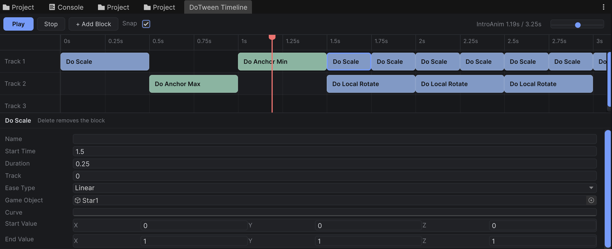

# DoTween Timeline Editor



A visual, track-based timeline editor for [DOTween](http://dotween.demigiant.com/) sequences in Unity.
Lay out tween blocks on tracks, drag and stretch them in time, scrub the result in Edit mode without
dirtying your scene, and play the same sequence at runtime from a single component.

- Unity **6000.3** (Unity 6), UI Toolkit editor window
- DOTween (free or Pro) in `Assets/Plugins/DOTween`
- Clean Runtime / Editor assembly split, so builds carry no `UnityEditor` code

---

## Table of Contents

- [Features](#features)
- [Getting Started](#getting-started)
- [Using the Timeline Window](#using-the-timeline-window)
- [Playing from Code](#playing-from-code)
- [Available Blocks](#available-blocks)
- [Architecture](#architecture)
- [Design Patterns](#design-patterns)
- [Extending: Writing Your Own Block](#extending-writing-your-own-block)
- [Project Layout](#project-layout)
- [Roadmap](#roadmap)

---

## Features

- **Track-based timeline window** with time ruler, playhead, zoom and horizontal scroll.
- **Drag to move, drag edges to resize** blocks; optional snapping (0.05 s steps).
- **Non-destructive Edit-mode preview**: scrub or play the sequence in the Scene view; every touched
  component is snapshotted first and restored when the preview stops.
- **Details panel** for the selected block (name, start time, duration, track, ease, target, custom curve, values).
- **Full Undo/Redo and prefab override support**: every edit goes through a `SerializedObject`.
- **Polymorphic blocks** stored with `[SerializeReference]`; new block types appear in the
  *Add Block* menu automatically.
- **Same data in Edit mode and Play mode**: the window forwards to the preview in Edit mode and to the
  component at runtime.

---

## Getting Started

1. Clone the repository and open it with Unity 6000.3 or newer.
   ```bash
   git clone https://github.com/Sanjay-V-Nair/DoTween-Timeline-Editor.git
   ```
2. Make sure DOTween is set up (**Tools > Demigiant > DOTween Utility Panel > Setup DOTween...**).
3. Select a GameObject and add the **`DoTweenTimeline`** component.
4. Click **Open Timeline Editor** in the component's inspector
   (or use **Window > DoTween Timeline** with the GameObject selected).
5. Click **+ Add Block**, pick a block type (for example *Transform / Do Scale*), assign a
   **Game Object**, and set the start and end values.
6. Press **Play** in the window to preview it in Edit mode. Press **Stop** to restore the scene.

The sample scenes in `Assets/Scenes` (`DoTweenTest`, `Sandbox`) contain ready-made timelines.

---

## Using the Timeline Window

| Action | How |
| --- | --- |
| Add a block | **+ Add Block** — the block is placed at the playhead, on the selected block's track |
| Move a block | Drag the block body: left/right changes start time, up/down changes track |
| Change duration | Drag the left or right edge of a block |
| Scrub | Click or drag in the time ruler |
| Play / Pause preview | **Play** button or `Space` |
| Stop preview (restore scene) | **Stop** button |
| Delete selected block | `Delete` or `Backspace` |
| Zoom | `Ctrl`/`Cmd` + mouse wheel, or the zoom slider |
| Scroll horizontally | `Shift` + mouse wheel, or trackpad horizontal swipe |
| Toggle snapping | **Snap** checkbox |
| Edit block values | Select a block; use the details panel at the bottom |

Blocks are colour-coded by category (Transform, UI). The window header shows the timeline name,
current time and total duration.

> **Edit mode vs Play mode:** in Edit mode the window drives `TimelinePreview`, which snapshots and
> restores your objects. In Play mode the window forwards Play / Pause / Scrub to the component itself.
> The preview stops automatically before scene save, scene close, domain reload and entering Play mode,
> so displaced objects are never saved.

---

## Playing from Code

`DoTweenTimeline` implements `ITimeline`:

```csharp
using DoTweenTimeline.Runtime;
using UnityEngine;

public class IntroController : MonoBehaviour {
    [SerializeField] private DoTweenTimeline introTimeline;

    private void Start() {
        introTimeline.Play();              // builds the DOTween Sequence on first use
    }

    public void OnSkipPressed() {
        introTimeline.SkipTo(3.25f, false); // jump to a time without playing
    }

    public void OnPausePressed() => introTimeline.OnPauseToggle();
}
```

| Member | Purpose |
| --- | --- |
| `Play()` | Builds the sequence if needed, then plays (restarts when it already finished) |
| `Pause()` / `Resume()` | Pause or continue playback |
| `OnPauseToggle()` | Toggle between paused and playing |
| `SkipTo(float t, bool isPlay = true)` | Go to time `t`, optionally continue playing |
| `IsPlaying`, `PlaybackTime` | Playback state |
| `Blocks` | Read-only list of the serialized `TweenBlock`s |
| `InvalidateSequence()` | Kill the built sequence; the next `Play()` rebuilds it |

The sequence is built lazily, linked to the GameObject (`SetLink`) and not auto-killed, so it can be
replayed.

---

## Available Blocks

### Transform (`DoTweenTimeline.Runtime.Block.Transform`)

| Block | Animates |
| --- | --- |
| `DoMoveBlock`, `DoLocalMoveBlock` | `position` / `localPosition` |
| `DoMoveXBlock`, `DoMoveYBlock`, `DoMoveZBlock` | One position axis |
| `DoRotateBlock`, `DoLocalRotateBlock` | Euler angles |
| `DoRotateQuaternionBlock`, `DoLocalRotateQuaternionBlock` | Rotation via quaternion slerp |
| `DoLookAtBlock` | Rotate to look at a Transform or point |
| `DoScaleBlock`, `DoScaleXBlock`, `DoScaleYBlock`, `DoScaleZBlock` | `localScale` (all or one axis) |
| `DoJumpBlock`, `DoLocalJumpBlock` | Jump arc with power and number of jumps |
| `DoPathBlock`, `DoLocalPathBlock` | Linear or Catmull-Rom path through points |
| `DoSpiralBlock` | Spiral around an axis (radius, turns, depth) |

### UI (`DoTweenTimeline.Runtime.Block.UI`)

| Block | Animates |
| --- | --- |
| `DoAnchorPosBlock`, `DoAnchorPosXBlock`, `DoAnchorPosYBlock` | `RectTransform.anchoredPosition` |
| `DoAnchorPos3DBlock` (+ `X`, `Y`, `Z`) | `anchoredPosition3D` |
| `DoJumpAnchorPosBlock` | Jump arc in anchored space |
| `DoSizeDeltaBlock` | `sizeDelta` |
| `DoAnchorMinBlock`, `DoAnchorMaxBlock` | Anchors |
| `DoPivotBlock`, `DoPivotXBlock`, `DoPivotYBlock` | Pivot |
| `DoFillAmountBlock` | `Image.fillAmount` |
| `DoFadeBlock` | `CanvasGroup.alpha`, or the alpha of a `Graphic` |
| `DoColorBlock` | `Graphic` colour, or `SpriteRenderer` colour |
| `DoBlendableColorBlock` | Additive, blendable colour change |

Every block shares these fields from `TweenBlock`: `name`, `startTime`, `duration`, `track`,
`easeType`, `gameObject` (target) and `curve` (a custom `AnimationCurve` that overrides `easeType`
when it has keys). Start values are explicit, so a sequence never depends on the object's state at
build time.

---

## Architecture

```
┌──────────────────────────── Editor assembly (DoTweenTimelineEditor) ───────────────────────────┐
│                                                                                                │
│  DoTweenTimelineInspector ──"Open Timeline Editor"──►  DoTweenTimelineEditorWindow : ITimeline │
│          │                                               │  (UI Toolkit view + controller,     │
│          │                                               │   styled by TimelineWindow.uss)     │
│          │                                               │                                     │
│          │                     Edit mode ┌───────────────┴──────────┐ Play mode                │
│          └──────────────────────────────►│      TimelinePreview     │──────────┐               │
│                                          │ snapshot ► build ► Goto  │          │               │
│  BlockInspector ◄── CustomBlockDrawer    │ restore on Stop          │          │               │
│  SubclassSelectorDrawer                  └──────────────┬───────────┘          │               │
└─────────────────────────────────────────────────────────┼──────────────────────┼───────────────┘
                                                          │ BuildPreviewSequence │ Play/Pause/SkipTo
┌──────────────────────────── Runtime assembly (DoTweenTimelineRuntime) ─────────┼───────────────┐
│                                                         ▼                      ▼               │
│                          DoTweenTimeline : MonoBehaviour, ITimeline                            │
│                          [SerializeReference] List<TweenBlock> tweens                          │
│                                   │                         │                                  │
│                                   ▼                         ▼                                  │
│                           SequenceBuilder              SequenceRunner                          │
│                     blocks ► DOTween.Sequence     Play / Pause / Goto / Reset                  │
│                                   │                                                            │
│                                   ▼                                                            │
│              TweenBlock (abstract) ── GenerateTween() ──► DG.Tweening.Tween                    │
│                 ├── Transform blocks (Move, Rotate, Scale, Jump, Path, Spiral, LookAt)         │
│                 └── UI blocks (AnchorPos, SizeDelta, Pivot, Fill, Fade, Color)                 │
└────────────────────────────────────────────────────────────────────────────────────────────────┘
```

### Data flow

1. **Authoring** — the window and inspector edit the component's `tweens` list through a
   `SerializedObject`. Each change triggers `OnValidate()`, which invalidates the built sequence.
2. **Build** — `SequenceBuilder.CreateSequence(blocks)` calls `GenerateTween()` on every block and
   inserts each tween at `block.startTime` into one `DOTween.Sequence`. Tweens with zero duration are
   killed instead of inserted.
3. **Run** — `SequenceRunner` owns the built sequence and wraps DOTween's playback calls with safety
   checks (inactive sequence, empty sequence, restart after completion).
4. **Preview (Edit mode only)** — `TimelinePreview` snapshots every component on the target objects,
   builds a separate preview sequence, ticks it through `DOTweenEditorPreview`, and restores the
   snapshot on `Stop()`.

### Key types

| Type | Assembly | Responsibility |
| --- | --- | --- |
| `DoTweenTimeline` | Runtime | Component that owns the block list, builder and runner; public playback API |
| `ITimeline` | Runtime | Shared playback contract: `Play`, `Pause`, `Resume`, `SkipTo` |
| `TweenBlock` | Runtime | Abstract base for one tween on the timeline; helpers for target lookup and easing |
| `SequenceBuilder` | Runtime | Turns a list of blocks into a `DG.Tweening.Sequence` |
| `SequenceRunner` | Runtime | Guards and drives playback of one sequence |
| `SubclassSelectorAttribute` | Runtime | Marks a `[SerializeReference]` field for the type picker |
| `DoTweenTimelineEditorWindow` | Editor | Track view, ruler, playhead, drag/resize, details panel |
| `TimelinePreview` | Editor | Static, global Edit-mode preview with snapshot / restore |
| `DoTweenTimelineInspector` | Editor | Component inspector with "Open Timeline Editor" and quick preview |
| `BlockInspector`, `BlockDrawer` | Editor | Draws a block's fields, with optional per-type custom drawers |
| `SubclassSelectorDrawer` | Editor | Concrete-type dropdown for `[SubclassSelector]` fields |

---

## Design Patterns

| Pattern | Where | Why |
| --- | --- | --- |
| **Template Method** | `TweenBlock.GenerateTween()` and intermediate bases such as `Vector3TransformBlock`, `FloatRectBlock`, `JumpTransformBlock` | The base class owns target lookup, tween creation and easing (`Finish`). A concrete block only overrides `Apply(target, value)`, often one line. |
| **Polymorphic serialization** | `[SerializeReference] List<TweenBlock>` + `SubclassSelector` | One list holds any mix of block types without a ScriptableObject per block. |
| **Builder** | `SequenceBuilder` | Separates *what* the timeline contains (blocks) from *how* a DOTween `Sequence` is assembled. |
| **Facade** | `SequenceRunner`, `DoTweenTimeline` | Hides DOTween edge cases (e.g. `Goto()` on an empty sequence throws, a completed sequence ignores `Play()`) behind a small, safe API. |
| **Strategy / shared interface** | `ITimeline` implemented by `DoTweenTimeline` and `DoTweenTimelineEditorWindow` | The window picks the right backend: `TimelinePreview` in Edit mode, the component in Play mode. |
| **Memento** | `TimelinePreview` snapshot (component → JSON) | Captures object state before preview and restores it after, so scrubbing never dirties the scene. |
| **Lazy initialization + invalidation** | `EnsureSequence()` / `InvalidateSequence()` | The sequence is built only when needed and rebuilt after any serialized change. |
| **Model–View–Controller** | Component = model, `TimelineWindow.uss` + `VisualElement`s = view, window = controller | The window holds no timeline data. All edits go through `SerializedObject`, so Undo, dirty flags and prefab overrides work for free. |
| **Registry via attributes / reflection** | `CustomBlockDrawerAttribute` + `TypeCache`; Add Block menu built from `TypeCache.GetTypesDerivedFrom<TweenBlock>()` | New blocks and drawers are discovered automatically; no central list to edit. |
| **Observer** | `TimelinePreview.Changed`, `SequenceRunner.OnShowWarningToast` | Inspector and window repaint on preview changes; runtime errors surface as editor toasts without a runtime → editor dependency. |

---

## Extending: Writing Your Own Block

Create a `[Serializable]` class that derives from `TweenBlock` (or one of the intermediate bases)
in the Runtime assembly. It appears in **+ Add Block** automatically.

```csharp
using System;
using DG.Tweening;
using UnityEngine;

namespace DoTweenTimeline.Runtime.Block.Audio {
    [Serializable]
    public class DoVolumeBlock : TweenBlock {
        [Range(0f, 1f)] public float startVolume = 0f;
        [Range(0f, 1f)] public float endVolume = 1f;

        public override Tween GenerateTween() {
            if (!TryGetTarget(out AudioSource source)) return null;   // logs a clear error when missing
            return Finish(DOTween.To(() => startVolume, v => source.volume = v, endVolume, duration));
        }
    }
}
```

Guidelines:

- Use explicit start values (`DOTween.To(() => start, setter, end, duration)`) instead of
  `DOMove`-style "from current" tweens, so preview and runtime always match.
- Always wrap the result in `Finish(...)` so the ease / custom curve is applied.
- Return `null` when the target is invalid; the builder skips it.
- The last namespace segment (`Audio` above) becomes the category in the Add Block menu.

Optional custom inspector for the details panel (Editor assembly):

```csharp
[CustomBlockDrawer(typeof(DoVolumeBlock))]
public class DoVolumeBlockDrawer : BlockDrawer {
    public override void OnGUI(SerializedProperty block) {
        BlockInspector.DrawDefault(block);
        EditorGUILayout.HelpBox("Needs an AudioSource on the target.", MessageType.Info);
    }
}
```

---

## Project Layout

```
Assets/
├── Plugins/DOTween/                  DOTween library
├── Scenes/                           DoTweenTest, Sandbox sample scenes
├── Sprites/SS_Tool.png               README screenshot
└── Scripts/
    ├── Runtime/                      DoTweenTimelineRuntime.asmdef (all platforms)
    │   ├── DoTweenTimeline.cs        The component
    │   ├── SubclassSelectorAttribute.cs
    │   ├── Block/
    │   │   ├── TweenBlock.cs         Abstract base
    │   │   ├── Transform/            Transform blocks + PathSampler
    │   │   └── UI/                   RectTransform / Graphic / Image blocks
    │   ├── SequenceBuilder/
    │   ├── SequenceRunner/
    │   └── Timeline/                 ITimeline
    └── Editor/                       DoTweenTimelineEditor.asmdef (Editor only)
        ├── DoTweenTimelineEditorWindow.cs
        ├── DoTweenTimelineInspector.cs
        ├── TimelinePreview.cs
        ├── BlockInspector.cs
        ├── SubclassSelectorDrawer.cs
        └── Styles/TimelineWindow.uss
```
---

## Roadmap

- [ ] Component validation with warnings and one-click **Fix It** actions
  (e.g. add a missing `CanvasGroup`, set `Image.type` to *Filled*)
- [ ] Tween modes: **To** (from current value), **FromTo**, **Relative**
- [ ] Timeline settings: loops, update mode, auto-play on `OnEnable` / `Start`
- [ ] Bookmarks and `SkipToBookmark`
- [ ] Audio and event / callback blocks
- [ ] Unity Asset Store package with demo scene and documentation
